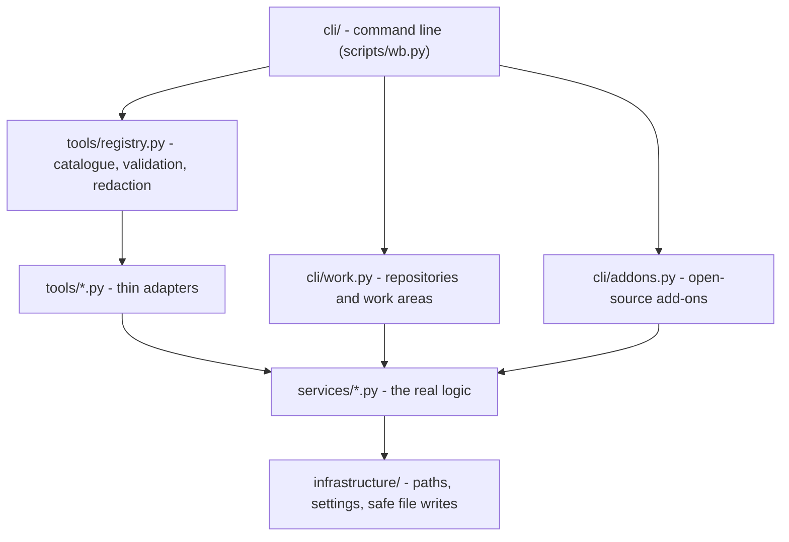

# Workbench Architecture

The workbench is a small Python program (standard library only, plus one optional package for PDFs) and a set of Markdown files that instruct the AI agents.

## Layers

| Layer | Folder | Rule |
|---|---|---|
| Command line | `src/agent_workbench/cli/` | Parses words, prints JSON, exits 1 on failure. No business logic. |
| Tool registry | `src/agent_workbench/tools/registry.py` | Reads `catalogue.json`; describes tools by reading source code with `ast` (no imports); imports a tool only when called; validates arguments; hides secrets in results. |
| Tools | `src/agent_workbench/tools/*.py` | Plain functions with keyword arguments and a docstring; return a dict with `success`. |
| Services | `src/agent_workbench/services/` | Work areas and pipeline status (`workspaces.py`), session start (`session.py`), session log, lessons, PDF source packs (`pdf_pack.py`), open-source add-ons (`addons.py`). Every function takes a `root` so tests can use a temporary folder. |
| Infrastructure | `src/agent_workbench/infrastructure/` | Finds the workbench root, reads `.env` lazily, writes files atomically. |

## The AI side

| File | Loaded | Purpose |
|---|---|---|
| `.github/copilot-instructions.md` | Automatically, in every chat | Shared team rules |
| `.github/agents/*.agent.md` | When you pick the agent | One role each: ProductManager, Developer, Tester, with handoff buttons between them |
| `.github/skills/*/SKILL.md` | On demand | Playbooks |
| `.github/prompts/*.prompt.md` | When you type `/name` | One focused task each |
| `.github/hooks/safety.json` | Before each tool call (where supported) | Runs `scripts/hooks/guard_commands.py`, which makes risky terminal commands ask for confirmation |

## Design principles

1. **Standard library first** — nothing to install for the core; pdfplumber only for PDF packs.
2. **Lazy, side-effect-free discovery** — `list` and `info` never import tools or read secrets.
3. **No global "current branch"** — each work area has its own record; tools receive `workspace_id` explicitly.
4. **One file per record** — `data/workspaces/<repo>/<branch-id>.json`, so parallel jobs never overwrite a shared list.
5. **Never destroy work** — creating a work area never switches the main clone; failures clean up only what they created.
6. **Secrets stay secret** — `.env` is never printed; results pass through `redacted()`.
7. **Guidance plus enforcement** — instructions guide the agents; tests and the safety hook enforce what must never break.
8. **Borrow, pin, review** — open-source add-ons are pinned to exact commits, fetched read-only, license-checked, and updated only after a review of what changed.

## Local data (never committed)

| Path | Written by |
|---|---|
| `data/workspaces/<repo>/<branch-id>.json` | `work create`, `work register`, `work note` |
| `working/<repo>/<branch-id>/` | `work create` (worktree, artifacts, changelog) |
| `sources/<name>/` | `pdf_source_pack` |
| `vendor/<name>/` | `addons fetch` (read-only clone at the pinned commit) |
| `.agents/skills/<name>/` and `.agents/skills/.addons-manifest.json` | `addons install-skills` (copied skills and a hash of every file) |

## Adding a tool

Follow `.github/skills/tool-builder/SKILL.md`: tests first, a service function, a thin adapter, a catalogue entry, then `info`, a real call, `python scripts/check_workbench.py`, and a row in the tools table of the team instructions.
