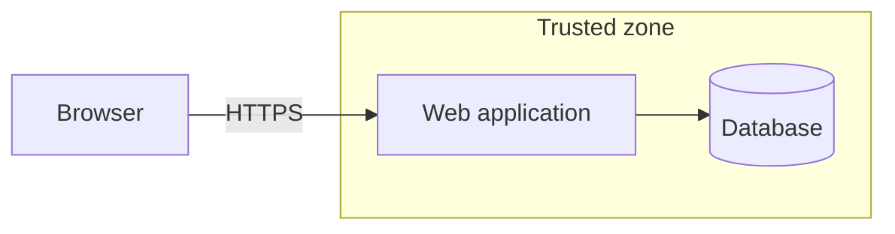
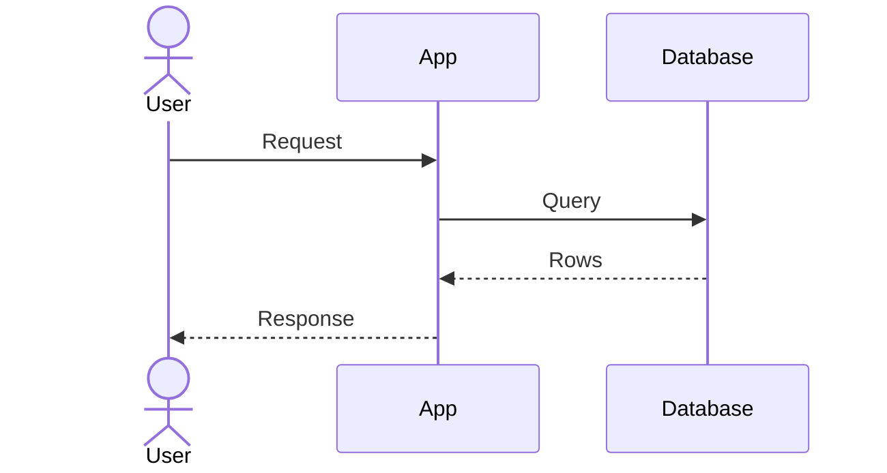

# Design: <product or feature name>

- **PRD:** docs/prd.md (version …)
- **Status:** Draft / In review / Approved
- **Last updated:** YYYY-MM-DD

## 1. Summary

Two or three sentences: what is being built and the main technical choices.

## 2. Architecture



## 3. Technology choices

| Area | Choice | Why | ADR |
|---|---|---|---|
| Front end | … | … | ADR-0001 |

## 4. Data model

| Entity | Fields (type) | Relationships | Owner | Personal data? | Retention |
|---|---|---|---|---|---|
| … | … | … | … | … | … |

## 5. Interfaces (API or commands)

| Method and path | Input | Output | Errors | Permission |
|---|---|---|---|---|
| … | … | … | … | … |

## 6. Key flows



## 7. Non-functional design

Performance budget · scaling assumptions · availability · backups and restore · logging, metrics and alerts (no personal data) · cost estimate.

## 8. Security

Link to the threat model and list the mitigations that shaped this design.

## 9. Delivery plan

| Slice | Requirements | Done when |
|---|---|---|
| 1. Walking skeleton | — | Runs locally end to end with one test |
| 2. … | R1, R2 | … |

Environments, deployment and rollback: …

---

# ADR template (one file per decision: docs/adr/NNNN-title.md)

```markdown
# ADR-NNNN: <decision title>

- Status: proposed | accepted | superseded by ADR-MMMM
- Date: YYYY-MM-DD

## Context
## Decision
## Consequences
## Alternatives considered
```
