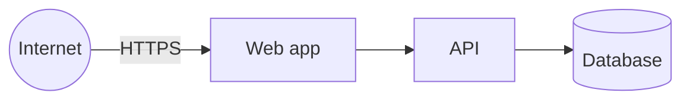

# Threat Model: <system name>

- **Version and date:** 0.1, YYYY-MM-DD
- **Scope:** what is and is not covered

## 1. System overview

- **Assets:** …
- **Actors:** users, admins, anonymous visitors, attackers
- **Entry points:** …
- **Trust boundaries:** …

## 2. Threats (STRIDE)

| ID | Component or flow | STRIDE | Threat | Likelihood | Impact | Mitigation | Status |
|---|---|---|---|---|---|---|---|
| T1 | Login | Spoofing | Password guessing | M | H | Rate limit, lockout, MFA option | Planned |

## 3. Privacy

| Data | Why needed | Retention | Deletion | Encrypted (transit / rest) |
|---|---|---|---|---|
| … | … | … | … | … |

Legal questions for an expert: …

## 4. Findings and decisions

| ID | Severity | Finding | Decision | Owner |
|---|---|---|---|---|
| … | … | … | … | … |
